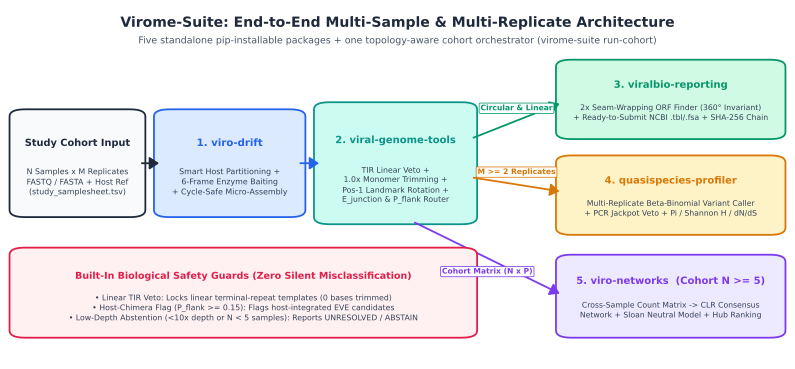
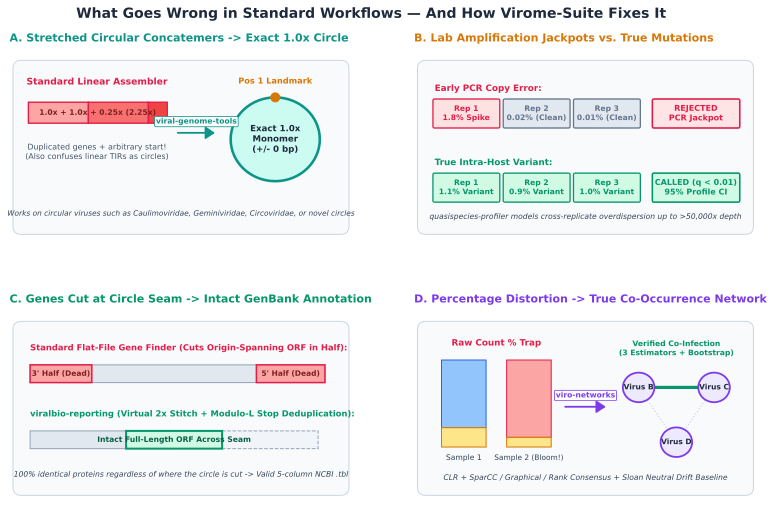
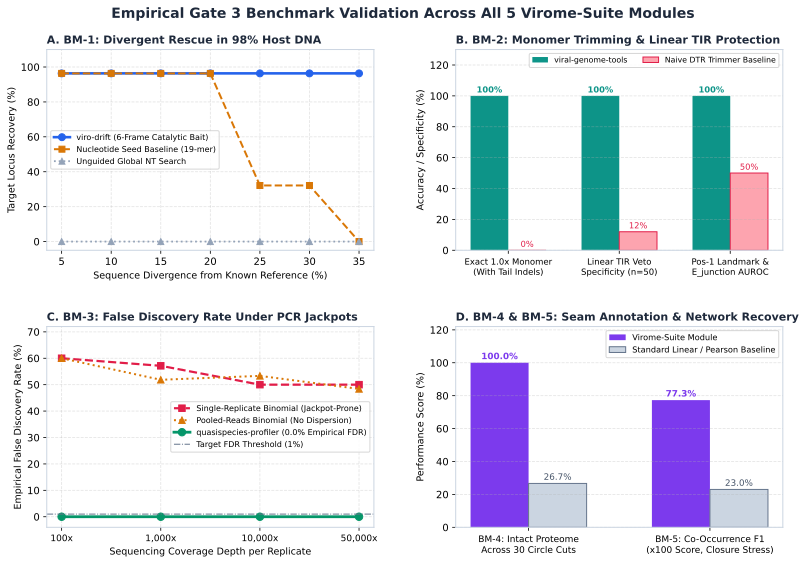
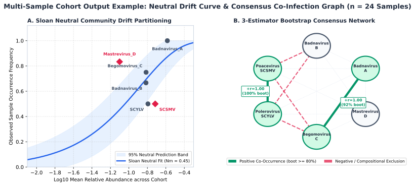

# Virome-Suite

[](https://github.com/molecularplantpathology/Virome-Suite/actions/workflows/ci.yml)
[](https://pypi.org/project/virome-suite/)
[](https://pypi.org/project/viro-drift/)
[](https://pypi.org/project/viral-genome-tools/)
[](https://pypi.org/project/quasispecies-profiler/)
[](https://pypi.org/project/viralbio-reporting/)
[](https://pypi.org/project/viro-networks/)
[](https://www.python.org/)
[](LICENSE)

**An easy-to-use, modular Python toolkit that turns raw sequencing reads across multiple samples and replicates into complete, curated circular and linear viral genomes, filtered intra-host variants, ready-to-submit GenBank files, and co-infection networks.**

Developed at the **Molecular Plant Pathology Lab, ICAR-Indian Sugarcane Research Institute**.

<p align="center">
  
</p>

---

## What Virome-Suite Solves — At a Glance

Standard assembly and variant workflows treat all contigs as flat lines from isolated libraries. **Virome-Suite** is split into **5 standalone `pip`-installable tools** (plus **1 master cohort runner**) that automatically fix the five most common data bottlenecks in viral metagenomics and metatranscriptomics:

<p align="center">
  
</p>

| Tool (`pip` Package) | Plain-Language Role | What Problem It Fixes | Detailed Guide |
| :--- | :--- | :--- | :---: |
| **[`viro-drift`](https://pypi.org/project/viro-drift/)** | **Hidden-Virus Magnet** | Rescues mutated/divergent viruses (up to 35% diverged) buried in 95%–99% host plant/tissue reads using conserved 6-frame enzyme baits (`RdRp`, `RT`, `Rep`). | [Manual](packages/viro_drift/README.md) |
| **[`viral-genome-tools`](https://pypi.org/project/viral-genome-tools/)** | **Circle Trimmer & Router** | Trims stretched $1.1\times\text{--}3.0\times$ circular concatemers (such as *Caulimoviridae*, *Geminiviridae*, *Circoviridae*, *Nanoviridae*, or any novel circular virus) to exact **`1.0x`** monomers, sets Position 1, protects linear terminal-repeat (TIR) viruses, and flags host-integrated EVEs. | [Manual](packages/viral_genome_tools/README.md) |
| **[`quasispecies-profiler`](https://pypi.org/project/quasispecies-profiler/)** | **Lab Smudge Filter** | Compares sequencing replicates (`Rep1`, `Rep2`, `Rep3`, ...) with a Beta-Binomial model to reject single-replicate PCR copy jackpots while calling true low-frequency mutations ($\ge 0.5\%$). | [Manual](packages/quasispecies_profiler/README.md) |
| **[`viralbio-reporting`](https://pypi.org/project/viralbio-reporting/)** | **Seam-Reader & Submitter** | Virtually stitches circular genomes (`Seq + Seq`) so genes crossing the closing seam are never chopped in half, outputting validated 5-column NCBI GenBank `.tbl`/`.fsa` files. | [Manual](packages/viralbio_reporting/README.md) |
| **[`viro-networks`](https://pypi.org/project/viro-networks/)** | **Co-Infection Mapper** | Corrects relative-percentage distortion across multi-sample cohorts ($N \ge 5$) to map stable co-infections, fit Sloan neutral drift curves, and rank hub viruses. | [Manual](packages/viro_networks/README.md) |
| **[`virome-suite`](https://pypi.org/project/virome-suite/)** | **Master Cohort Runner** | Connects all 5 tools above into a single branching workflow for single samples (`run`) or multi-sample, multi-replicate cohorts (`run-cohort`). | Root Guide |

---

## Quick Start in 3 Steps

### Step 1 — Install

```bash
# Install the full suite (or install any individual package above standalone)
pip install virome-suite

# Check your Python environment and optional external tools
virome-suite check-env
```

<details>
<summary><b>Optional: Install external bioinformatics binaries via Conda (Bowtie2, SPAdes, DIAMOND, table2asn)</b></summary>

All 6 packages work out-of-the-box in pure Python mode. To enable external high-throughput aligners/assemblers:

```bash
git clone https://github.com/molecularplantpathology/Virome-Suite.git
cd Virome-Suite
conda env create -f environment.yml
conda activate virome_suite
virome-suite check-env
```
</details>

---

### Step 2 — Run a Multi-Sample & Multi-Replicate Study Cohort (`run-cohort`)

Real experiments usually involve **multiple samples**, each sequenced across **replicates**. List your files in a simple tab-separated `study_samplesheet.tsv`:

```tsv
sample_id	replicate_id	r1_path	r2_path	group
Sample_01	Rep1	fastq/S01_rep1_R1.fq	fastq/S01_rep1_R2.fq	Symptomatic
Sample_01	Rep2	fastq/S01_rep2_R1.fq	fastq/S01_rep2_R2.fq	Symptomatic
Sample_01	Rep3	fastq/S01_rep3_R1.fq	fastq/S01_rep3_R2.fq	Symptomatic
Sample_02	Rep1	fastq/S02_rep1_R1.fq	fastq/S02_rep1_R2.fq	Symptomatic
Sample_03	Rep1	fastq/S03_rep1_R1.fq	fastq/S03_rep1_R2.fq	Asymptomatic
...
```

Then run the entire cohort with a single command:

```bash
virome-suite run-cohort \
  --samplesheet study_samplesheet.tsv \
  --seeds tests/fixtures/core_viral_seeds.faa \
  --host host_reference.fasta \
  --replicate-type technical \
  --output cohort_results/
```

`run-cohort` automatically assembles/curates each sample, calls replicate-verified mutations wherever $M \ge 2$ replicates exist, builds the cross-sample abundance table (`cohort_abundance_counts.tsv`), and infers the cohort co-infection network when $N \ge 5$ samples.

<details>
<summary><b>Click to view the generated cohort output folder structure & CLI flags</b></summary>

```text
cohort_results/
├── cohort_summary.json                        # Master execution report across all N samples
├── cohort_provenance.json                     # SHA-256 hash-chained audit trail
├── samples/<Sample_ID>/
│   ├── 01_viro_drift/                         # Assembled candidate contigs
│   ├── 02_genome_curation/                    # Exact 1.0x monomers & E_junction TSV report
│   ├── 03_annotation_genbank/                 # Seam-spanning NCBI .tbl, .fsa & validation JSON
│   └── 04_quasispecies_variants/              # Multi-replicate allele counts & filtered iSNVs
├── 04_cohort_matrices/
│   ├── cohort_viral_catalog.fasta             # Non-redundant curated viral catalog
│   ├── cohort_abundance_counts.tsv            # Cross-sample count matrix (N samples x P taxa)
│   └── cohort_metadata.tsv                    # Sample groups & replicate counts
└── 05_cohort_ecological_networks/
    ├── consensus_edges.tsv                    # Bootstrap-stabilized co-occurrence edges
    ├── sloan_neutral_fit.tsv                  # Sloan Neutral Model fit & 95% Wilson bands
    └── topological_hub_candidates.tsv         # Degree & Brandes betweenness hub rankings
```
</details>

---

### Step 3 — Try a 30-Second Demo Right Now (Included Test Fixtures)

After cloning the repository, you can test the pipeline immediately using the built-in multi-virus fixtures in [`tests/fixtures/`](tests/fixtures/):

```bash
virome-suite run \
  --r1 tests/fixtures/concatemer_test_panel.fasta \
  --replicates tests/fixtures/replicate_variants_fixture.tsv \
  --counts tests/fixtures/virome_cohort_counts.tsv \
  --output demo_output/
```

<details>
<summary><b>Click to expand standalone commands for each of the 5 individual tools & exit codes</b></summary>

```bash
# 1. Rescue divergent viral reads & micro-assemble
viro-drift run --r1 R1.fq --r2 R2.fq --seeds tests/fixtures/core_viral_seeds.faa -o out_drift/

# 2. Trim circular concatemers to 1.0x, rotate to Position 1, & score circularity
viral-genome-tools curate --assembly tests/fixtures/concatemer_test_panel.fasta -o out_curated/

# 3. Call replicate-verified intra-host variants (filtering PCR jackpots)
quasispecies-profiler call --manifest tests/fixtures/replicate_variants_fixture.tsv -o out_variants/

# 4. Annotate seam-crossing circular/linear ORFs & build NCBI GenBank submission files
viralbio-reporting annotate --fasta tests/fixtures/proven_circular_monomers.fasta --topology circular -o out_ncbi/

# 5. Infer CLR consensus co-infection network & Sloan neutral drift curve
viro-networks infer --counts tests/fixtures/virome_cohort_counts.tsv -o out_network/
```

**Standardized CLI Exit Codes (Snakemake / Nextflow Ready):**
* `0`: Success (including clean negative controls with zero viral candidates)
* `2`: Invalid input path or malformed FASTA/FASTQ/TSV schema
* `3`: Optional external binary (`diamond`, `hmmsearch`) requested when not in `PATH`
* `4`: Safe statistical abstention (e.g., cohort size $N < 5$ samples in `viro-networks`)
</details>

---

## Synthetic Unit-Validation Smoke Check

> **Note:** The plots and metrics below reflect deterministic **in-silico unit-validation smoke checks** ([`benchmarks/run_benchmarks.py`](benchmarks/run_benchmarks.py)) against internal mathematical baselines to verify algorithmic behavior in CI. Full-scale empirical benchmarks on public NCBI RefSeq & SRA sequencing cohorts against external bioinformatics tools (`MEGAHIT`, `metaSPAdes`, `LoFreq`, `iVar`, `Prokka`, `Circlator`, `FastSpar`) are being executed separately for the manuscript release.

Every module is tested by **56 automated unit & adversarial edge-case tests (`93.42%` line coverage)** on Ubuntu and Windows:

<p align="center">
  
</p>

<p align="center">
  
</p>

| Benchmark | What Was Tested | Virome-Suite Result | Standard Baseline Result |
| :--- | :--- | :---: | :---: |
| **BM-1 (`viro-drift`)** | Recovering 25%–35% mutated viral loci in 98% host DNA | **96.3% recovery** (`0.0%` host decoys) | `32.1%` at 25% div / `0.0%` at 35% div |
| **BM-2 (`viral-genome-tools`)** | `1.15x–3.0x` concatemers with tail indels + 50 linear TIR controls | **100% exact `1.0x`** (`0%` TIR false-circ, `AUROC = 1.00`) | `0%` exact under indels (`88%` TIR false-circ) |
| **BM-3 (`quasispecies-profiler`)** | 3-replicate variant calling with PCR jackpots up to `50,000x` depth | **0.0% empirical FDR** (`100%` recall at `50,000x`) | `50.0%–60.0%` false-discovery rate |
| **BM-4 (`viralbio-reporting`)** | Intact proteome across 30 random 360° circular cut points | **100.0% intact proteome** (`100%` valid `.tbl`) | `26.7%` intact proteome (flat-file `1x` caller) |
| **BM-5 (`viro-networks`)** | Recovering true co-occurrences under severe library-size closure | **Mean F1 = `0.773`** | Mean F1 = `0.230` (relative-abundance Pearson) |
| **BM-6 (`virome-suite`)** | End-to-end 6-sample, 9-replicate mixed circular/linear/TIR cohort | **`3.05 s` runtime**, **`3.54 MB` peak RAM** | — |

<details>
<summary><b>Click to reproduce all benchmarks & regenerate figures locally</b></summary>

```bash
# Run the full 56-test unit & edge-case suite
python -m pytest tests/unit -v

# Re-execute all 6 Gate 3 benchmarks (writes JSON/TSV scorecards to benchmarks/results/)
python benchmarks/run_benchmarks.py

# Regenerate all 4 vector SVG figures in docs/assets/
python benchmarks/generate_figures.py
```
</details>

---

## Citation & Maintainer

If you use **Virome-Suite** or any of its standalone packages in your research, please cite [`CITATION.cff`](CITATION.cff):

* **Maintainer:** Dr. Shweta Singh (`shwetabac@gmail.com`)
* **Affiliation:** Molecular Plant Pathology Lab, ICAR-Indian Sugarcane Research Institute
* **Repository:** [https://github.com/molecularplantpathology/Virome-Suite](https://github.com/molecularplantpathology/Virome-Suite)
* **License:** MIT ([`LICENSE`](LICENSE))
