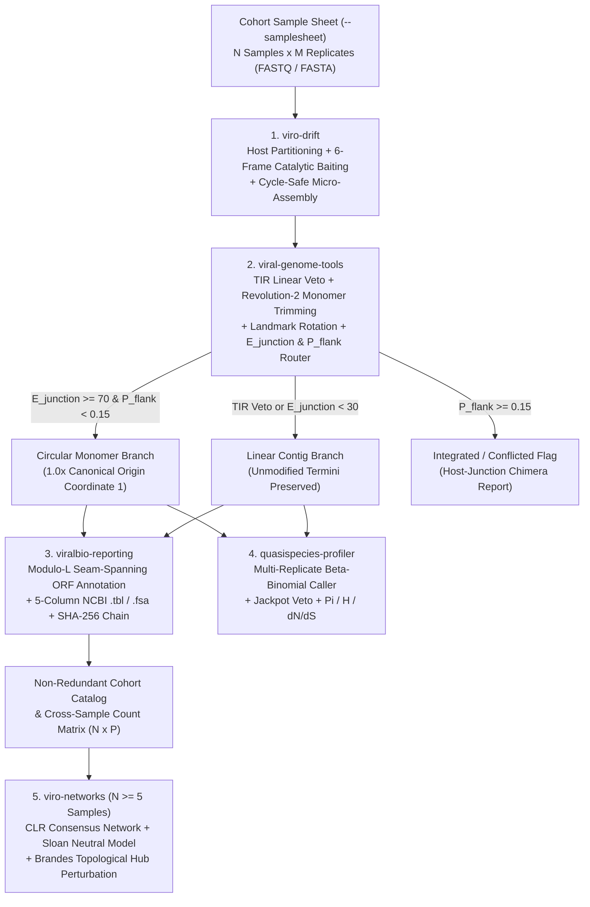

# Virome-Suite

[](https://github.com/molecularplantpathology/Virome-Suite/actions/workflows/ci.yml)
[](https://pypi.org/project/virome-suite/)
[](https://pypi.org/project/viro-drift/)
[](https://pypi.org/project/viral-genome-tools/)
[](https://pypi.org/project/quasispecies-profiler/)
[](https://pypi.org/project/viralbio-reporting/)
[](https://pypi.org/project/viro-networks/)
[](https://www.python.org/)
[](LICENSE)

**A Modular, Topology-Aware Python Ecosystem for Divergent Sequence Rescue, Circular Concatemer Monomerization, Replicate-Aware Intra-Host Variant Calling, Seam-Spanning GenBank Annotation, and Multi-Sample Ecological Network Inference.**

Developed at the **Molecular Plant Pathology Lab, ICAR-Indian Sugarcane Research Institute**.

---

## Why Virome-Suite?

Standard metagenomic and metatranscriptomic workflows treat all assembled contigs as static linear strings from single isolated libraries. In practice, real virome studies fail at five recurring failure points that **Virome-Suite** resolves mathematically:

1. **Divergent Sequence Dropout (`viro-drift`):** Nucleotide aligners lose sensitivity beyond 20%–30% sequence divergence. `viro-drift` partitions host reads without discarding host-junction evidence, masks low-entropy homopolymers ($H < 1.20\text{ bits}$), baits conserved 6-frame catalytic motifs (`RdRp`, `RT`, `Rep`), and executes two-phase cycle-safe de Bruijn micro-assembly.
2. **Circular Tandem Concatemers & Endogenous Element Confusion (`viral-genome-tools`):** Short-read assemblers stretch circular DNA templates (*Caulimoviridae*, *Geminiviridae*, *Circoviridae*, *Nanoviridae*) into $1.1\times\text{--}3.0\times$ tandem concatemers at arbitrary cut coordinates. `viral-genome-tools` enforces a Terminal Inverted Repeat (TIR) linear veto, solves exact $1.0\times$ monomer periodicity via Revolution-2 banded alignment, rotates Coordinate 1 to biological origin landmarks (`tRNA-Met` PBS, `TAATATTAC` stem-loop), and scores physical circularity ($E_{\text{junction}} \in [0, 100]$) orthogonally from host integration ($P_{\text{flank}}$).
3. **Single-Replicate Amplification Jackpots (`quasispecies-profiler`):** Standard low-frequency callers treat sequencing technical or biological replicates independently, calling early-cycle amplification jackpots as false variants. `quasispecies-profiler` models counts across $M$ replicates via a hierarchical Empirical Bayes Beta-Binomial likelihood with vectorized null parametric bootstrap FDR calibration and 95% profile likelihood confidence intervals.
4. **Origin-Broken Circular Genes (`viralbio-reporting`):** Linear ORF finders truncate genes crossing the circular coordinate-1 seam and break NCBI `table2asn` submissions. `viralbio-reporting` guarantees 360° rotation-invariant ORF discovery on $2\times$ virtual templates via modulo-$L$ biological stop deduplication and projects exact 1-based compound intervals on both `(+)` and `(-)` strands with hash-chained SHA-256 provenance.
5. **Compositional Closure Bias Across Study Cohorts (`viro-networks`):** Raw read-count correlations across multi-sample surveys generate spurious edges due to sequencing library-size closure. `viro-networks` combines Centered Log-Ratio (CLR) normalization, a 3-estimator bootstrap consensus network (positive-floored SparCC + shrinkage graphical partial correlation + Spearman rank), Sloan Neutral Community Model fitting, and topological hub perturbation.

---

## System Architecture & Multi-Sample Cohort Dataflow



---

## Modular Ecosystem Overview

Each component is published on PyPI as an **independent, zero-cross-import Python package** so researchers can install either the complete `virome-suite` orchestrator or any standalone tool individually:

| Distribution (PyPI) | CLI Executable | Python Namespace | Detailed Package Manual | Core Dependencies |
| :--- | :--- | :--- | :--- | :--- |
| **[`viro-drift`](https://pypi.org/project/viro-drift/)** | `viro-drift` | `viro_drift` | [`packages/viro_drift/README.md`](packages/viro_drift/README.md) | `numpy`, `biopython` |
| **[`viral-genome-tools`](https://pypi.org/project/viral-genome-tools/)** | `viral-genome-tools` | `viral_genome_tools` | [`packages/viral_genome_tools/README.md`](packages/viral_genome_tools/README.md) | `numpy`, `biopython` |
| **[`quasispecies-profiler`](https://pypi.org/project/quasispecies-profiler/)** | `quasispecies-profiler` | `quasispecies_profiler` | [`packages/quasispecies_profiler/README.md`](packages/quasispecies_profiler/README.md) | `numpy`, `scipy`, `pandas` |
| **[`viralbio-reporting`](https://pypi.org/project/viralbio-reporting/)** | `viralbio-reporting` | `viralbio_reporting` | [`packages/viralbio_reporting/README.md`](packages/viralbio_reporting/README.md) | `biopython`, `pandas` |
| **[`viro-networks`](https://pypi.org/project/viro-networks/)** | `viro-networks` | `viro_networks` | [`packages/viro_networks/README.md`](packages/viro_networks/README.md) | `numpy`, `scipy`, `pandas` |
| **[`virome-suite`](https://pypi.org/project/virome-suite/)** | `virome-suite` | `orchestrator` | Root Orchestrator (this manual) | All 5 packages above |

---

## Installation

### Option A: Install Complete Ecosystem from PyPI (Recommended)

```bash
pip install virome-suite
```

### Option B: Install Individual Domain Packages Standalone

```bash
pip install viro-drift
pip install viral-genome-tools
pip install quasispecies-profiler
pip install viralbio-reporting
pip install viro-networks
```

### Option C: Conda Environment with External Bioinformatics Binaries

All 6 Python packages operate out-of-the-box in pure Python/NumPy/SciPy/Biopython mode. To enable optional external accelerators (`bowtie2`, `spades.py`, `megahit`, `diamond`, `hmmer`, `samtools`, `lofreq`, `table2asn`), create the Conda environment from [`environment.yml`](environment.yml):

```bash
git clone https://github.com/molecularplantpathology/Virome-Suite.git
cd Virome-Suite
conda env create -f environment.yml
conda activate virome_suite
virome-suite check-env
```

---

## Multi-Sample & Multi-Replicate Cohort Workflow (`virome-suite run-cohort`)

In standard field surveys and experimental studies, sequencing is performed across **multiple biological samples**, each often sequenced in **2–4 technical or biological replicates**. `virome-suite run-cohort` automates the entire multi-sample, multi-replicate workflow from a single tab-separated (`TSV`) or comma-separated (`CSV`) sample sheet.

### 1. Prepare `study_samplesheet.tsv`

Create a TSV file listing each sample and its replicate libraries (`r2_path` can be left blank or `NA` for single-end reads or pre-assembled contigs; relative paths are resolved automatically relative to the sample sheet directory):

```tsv
sample_id	replicate_id	r1_path	r2_path	group
Field_S01	Rep1	fastq/S01_rep1_R1.fq	fastq/S01_rep1_R2.fq	Symptomatic
Field_S01	Rep2	fastq/S01_rep2_R1.fq	fastq/S01_rep2_R2.fq	Symptomatic
Field_S01	Rep3	fastq/S01_rep3_R1.fq	fastq/S01_rep3_R2.fq	Symptomatic
Field_S02	Rep1	fastq/S02_rep1_R1.fq	fastq/S02_rep1_R2.fq	Symptomatic
Field_S02	Rep2	fastq/S02_rep2_R1.fq	fastq/S02_rep2_R2.fq	Symptomatic
Field_S03	Rep1	fastq/S03_rep1_R1.fq	fastq/S03_rep1_R2.fq	Asymptomatic
Field_S04	Rep1	fastq/S04_rep1_R1.fq	fastq/S04_rep1_R2.fq	Asymptomatic
Field_S05	Rep1	fastq/S05_rep1_R1.fq	fastq/S05_rep1_R2.fq	Symptomatic
Field_S06	Rep1	fastq/S06_rep1_R1.fq	fastq/S06_rep1_R2.fq	Asymptomatic
```

### 2. Execute the Cohort Pipeline

```bash
virome-suite run-cohort \
  --samplesheet study_samplesheet.tsv \
  --seeds tests/fixtures/core_viral_seeds.faa \
  --host host_reference.fasta \
  --replicate-type technical \
  --alpha 0.01 \
  --bootstraps 100 \
  --stability 0.80 \
  --output cohort_results/
```

### 3. What `run-cohort` Executes Automatically

1. **Per-Sample Replicate Pooling & Discovery:** Pools replicate reads within each `sample_id` to maximize assembly contiguity, runs `viro-drift` (when `--seeds` is provided), curates circular/linear topologies with `viral-genome-tools`, and generates GenBank `.tbl`/`.fsa` packages via `viralbio-reporting`.
2. **Automatic Multi-Replicate Pileup & Variant Calling:** For every sample with $M \ge 2$ replicates (`Rep1`, `Rep2`, `Rep3`, ...), aligns each replicate independently back to the sample's curated reference genome, builds `auto_replicate_counts.tsv`, and executes `quasispecies-profiler` to separate true intra-host variants from single-replicate jackpots.
3. **Cross-Sample Catalog Deduplication & Abundance Matrix Construction:** Builds a non-redundant viral reference catalog (`cohort_viral_catalog.fasta`) across all samples and quantifies per-sample abundance in `04_cohort_matrices/cohort_abundance_counts.tsv` alongside `cohort_metadata.tsv`.
4. **Cohort Ecological Network & Neutral Drift Modeling:** When $N \ge 5$ samples and $P \ge 2$ taxa are present, automatically executes `viro-networks infer` to produce consensus co-occurrence edges, Sloan neutral model partitions, and topological hub vulnerability rankings (safely abstaining with `ABSTAIN_INSUFFICIENT_SAMPLES` when $N < 5$).

### 4. Cohort Output Directory Structure

```text
cohort_results/
├── cohort_summary.json                        # Master execution report across all N samples
├── cohort_provenance.json                     # Append-only SHA-256 hash-chained audit log
├── samples/
│   ├── Field_S01/
│   │   ├── 01_viro_drift/                     # Assembled candidate contigs & seed baiting stats
│   │   ├── 02_genome_curation/                # 1.0x canonical monomers & E_junction TSV report
│   │   ├── 03_annotation_genbank/             # Seam-spanning NCBI .tbl, .fsa & validation JSON
│   │   └── 04_quasispecies_variants/          # Multi-replicate allele table, called iSNVs & diversity
│   ├── Field_S02/
│   └── ...
├── 04_cohort_matrices/
│   ├── cohort_viral_catalog.fasta             # Non-redundant curated viral reference catalog
│   ├── cohort_abundance_counts.tsv            # Cross-sample count matrix (N samples x P taxa)
│   └── cohort_metadata.tsv                    # Sample group & replicate count metadata
└── 05_cohort_ecological_networks/
    ├── consensus_edges.tsv                    # Bootstrap-stabilized 3-estimator co-occurrence edges
    ├── sloan_neutral_fit.tsv                  # Sloan Neutral Model Nm fit, R^2 & Wilson 95% bands
    ├── topological_hub_candidates.tsv         # Degree, Brandes betweenness & natural connectivity drop
    └── network_summary.json                   # Pseudocount sensitivity & model diagnostics
```

---

## Single-Sample Workflow & 30-Second Reproducible Demo

After cloning the repository (or installing `virome-suite`), you can test every single module immediately using the multi-family ground-truth validation fixtures in [`tests/fixtures/`](tests/fixtures/):

```bash
# 1. Check Python scientific dependencies and optional external tools
virome-suite check-env

# 2. Run the full single-sample pipeline on tandem concatemers + 3-replicate variants + 24-sample cohort counts
virome-suite run \
  --r1 tests/fixtures/concatemer_test_panel.fasta \
  --replicates tests/fixtures/replicate_variants_fixture.tsv \
  --counts tests/fixtures/virome_cohort_counts.tsv \
  --output demo_output/
```

---

## Standalone CLI Quick-Reference Across All 5 Domain Packages

Every domain tool can be run independently from the command line without invoking the master orchestrator:

```bash
# Package 1: Divergent catalytic seed baiting & local micro-assembly
viro-drift run \
  --r1 sample_R1.fastq \
  --r2 sample_R2.fastq \
  --seeds tests/fixtures/core_viral_seeds.faa \
  --host host_genome.fasta \
  --mode kmer_seed \
  -o out_01_drift/

# Package 2: Circular concatemer monomerization, landmark rotation & E_junction scoring
viral-genome-tools curate \
  --assembly tests/fixtures/concatemer_test_panel.fasta \
  --r1 sample_R1.fastq \
  --r2 sample_R2.fastq \
  --insert-size 350 \
  -o out_02_curated/

# Package 3: Multi-replicate Empirical Bayes Beta-Binomial variant calling
quasispecies-profiler call \
  --manifest tests/fixtures/replicate_variants_fixture.tsv \
  --ref tests/fixtures/proven_circular_monomers.fasta \
  --replicate-type technical \
  --alpha 0.01 \
  -o out_03_variants/

# Package 4: Rotation-invariant circular/linear ORF annotation & NCBI .tbl/.fsa builder
viralbio-reporting annotate \
  --fasta tests/fixtures/proven_circular_monomers.fasta \
  --topology circular \
  --min-aa 60 \
  --organism "Sugarcane bacilliform virus" \
  --host "Saccharum officinarum" \
  -o out_04_ncbi/

# Package 5: Compositional consensus network, Sloan neutral model & hub perturbation
viro-networks infer \
  --counts tests/fixtures/virome_cohort_counts.tsv \
  --bootstraps 100 \
  --stability 0.80 \
  -o out_05_networks/
```

### Standardized CLI Exit Code Contract

All 6 CLI executables enforce identical, machine-readable exit codes for workflow integration (Snakemake, Nextflow, Slurm):

| Exit Code | Meaning | Example Trigger |
| :---: | :--- | :--- |
| **`0`** | Clean completion | Valid run completed (including clean negative control with `NO_VIRAL_CANDIDATES`) |
| **`2`** | Input / validation error | Missing input file, mismatched paired read counts, or malformed TSV schema |
| **`3`** | Missing external binary | `--mode diamond` or `--mode hmmer` requested when binary is absent from `PATH` |
| **`4`** | Safe statistical abstention | Cohort size $N < 5$ samples in `viro-networks infer` (`ABSTAIN_INSUFFICIENT_SAMPLES`) |

---

## Verification, Testing & Continuous Integration

The repository is continuously verified on **Ubuntu (`ubuntu-latest`)** and **Windows (`windows-latest`)** across Python `3.10`, `3.11`, and `3.12` via [`.github/workflows/ci.yml`](.github/workflows/ci.yml), enforcing $\ge 85\%$ line coverage individually on every package (currently **>93% ecosystem coverage across 56 automated tests**):

```bash
python -m pytest tests/unit -v \
  --cov=viro_drift \
  --cov=viral_genome_tools \
  --cov=quasispecies_profiler \
  --cov=viralbio_reporting \
  --cov=viro_networks \
  --cov=orchestrator \
  --cov-report=term-missing
```

---

## Citation & Governance

If you use **Virome-Suite** or any of its standalone domain packages in published research, please cite [`CITATION.cff`](CITATION.cff):

* **Maintainer:** Dr. Shweta Singh (`shwetabac@gmail.com`)
* **Institution:** Molecular Plant Pathology Lab, ICAR-Indian Sugarcane Research Institute
* **Source Repository:** [https://github.com/molecularplantpathology/Virome-Suite](https://github.com/molecularplantpathology/Virome-Suite)
* **License:** MIT License ([`LICENSE`](LICENSE))
